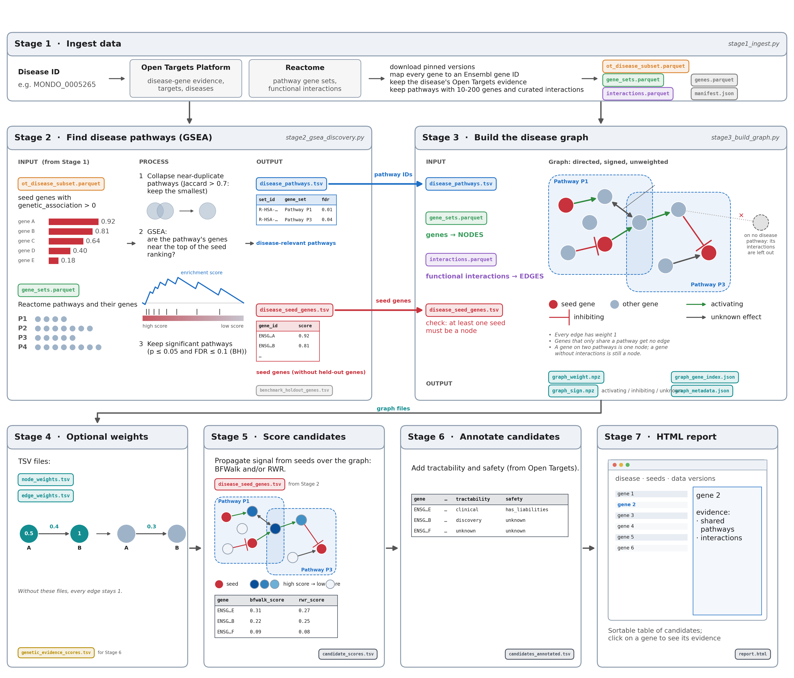

# Targets from Pathways

> The scientific idea was introduced by Jędrzej Kubica, Polina Rusina, Siddharth Sethi and Elvis Poku-Adusei at the Open Targets Hackathon on October 21-22, 2025. The technology was created by agentic AI provided by Claude Sonnet 4.6 and Opus 5.5. The original project is available under the MIT license at [https://github.com/jedrzejkubica/targets-from-pathways](https://github.com/jedrzejkubica/targets-from-pathways)


## Overview

Given a disease, the pipeline proposes candidate drug targets from pathway topology. First, the pipeline finds disease-relevant pathways from Reactome using the GSEA of disease-associated genes. Second, it builds an unweighted graph of functional interactions between all genes on these pathways. It then propagates the signal from seeds (i.e. disease-associated genes) over the graph (using [BFWalk](https://github.com/jedrzejkubica/BFWalk) and/or [Random Walk with Restart](https://github.com/anthbapt/multixrank)) to rank every non-seed gene as a drug target candidate, and annotates the ranking with Open Targets tractability and safety. The result is an interactive HTML report.




## Installation

```
pip install -r requirements.txt
```

>Note: [BFWalk](https://github.com/jedrzejkubica/BFWalk), Stage 5's default method, is not on PyPI yet:
`requirements.txt` installs it from TestPyPI.

Check the installation:

```
python pipeline/run_pipeline.py --help
```

It imports every stage first, so if it prints the help, every package is installed; otherwise it lists
what is missing. `python -m pytest` runs the test suite (without any downloads).


## Usage

**Whole pipeline**, one disease to `out/report.html`:

```
python pipeline/run_pipeline.py --disease MONDO_0005265 --data-dir data/ --out-dir out/ --report
```

**Stage by stage** - each stage reads the previous stage's files in `out/` (`--help` lists all options):

| Stage | What it does | Command |
|---|---|---|
| 1 | Downloads the pinned Open Targets + Reactome data and maps every gene to an Ensembl ID. | `python pipeline/stage1_ingest.py --disease MONDO_0005265 --data-dir data/ --out-dir out/` |
| 2 | Runs GSEA of disease-associated genes against the Reactome pathways. | `python pipeline/stage2_gsea_discovery.py --manifest out/manifest.json` |
| 3 | Builds the disease graph: the functional interactions between genes of the GSEA pathways. | `python pipeline/stage3_build_graph.py --manifest out/manifest.json` |
| 4 | Optionally weights the graph with your own node and/or edge weights (`--node-weights`, `--edge-weights`; both optional TSV files). | `python pipeline/stage4_weights.py --manifest out/manifest.json` |
| 5 | Propagates the signal from seeds and ranks candidate genes (`--method bfwalk`, `rwr` or `bfwalk,rwr`). | `python pipeline/stage5_score_candidates.py --graph-dir out/` |
| 6 | Adds Open Targets tractability and safety to the candidates. | `python pipeline/stage6_annotate_context.py --manifest out/manifest.json` |
| 7 | Writes the HTML report. | `python pipeline/stage7_report.py --run-dir out/` |

BFWalk is designed to be less biased towards highly connected hub genes than RWR: use it to find candidates beyond
well-studied hubs, and use RWR when you prefer well-connected genes close to the seeds.

See [docs/README.md](docs/README.md) for each stage's inputs, outputs and options.


## Data

Stage 1 downloads the pinned versions into `--data-dir` on the first run (~1.5 GB), checks
their sha256, and reuses them afterwards:

- [Open Targets Platform](https://platform.opentargets.org/) 26.06: `association_by_datasource_direct`
  (disease-gene evidence), `target` (gene identifiers, tractability, safety) and `disease`.
- [Reactome](https://reactome.org/) release 97: `ReactomePathways.gmt` (pathway gene sets) and
  `Ensembl2Reactome.txt`; [Reactome functional interactions](https://reactome.org/tools/reactome-fiviz)
  `FIsInGene_04142025_with_annotations.txt`.

Every stage writes into the run directory (`--run-dir`): parquet tables from Stage 1, TSV tables
(`disease_pathways.tsv`, `candidate_scores.tsv`, `candidates_annotated.tsv`, ...), the graph as sparse
matrices (`graph_weight.npz`, `graph_sign.npz`) with `graph_gene_index.json`, and `report.html`.

## Development history

See [development/README.md](development/README.md) and [development/prompt_history](development/prompt_history).

## Validation

See [validation/README.md](validation/README.md).
