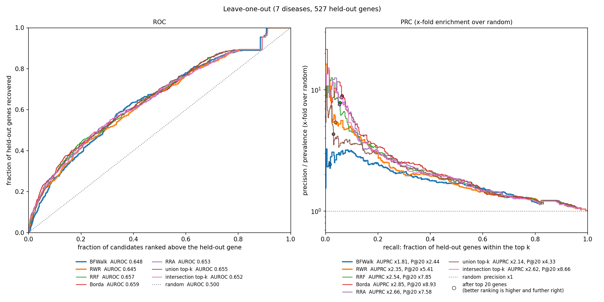

# Validation

Here, we built a **disease graph catalogue**: one graph per disease from a disease-pathway GSEA catalogue (>2500 diseases in total). Every disease graph contains genes on disease-relevant pathways and functional interactions between them. The graph catalogue can be used to find new disease-specific genes and/or drug target candidates based on pathway topology. 


We **evaluated the pipeline** to test if it can recover known disease-associated genes using leave-one-out cross-validation: we iteratively hold out each of the disease-associated genes and checked how highly the pipeline ranked it. We also examined the complementarity of the two network propagation algorithms (BFWalk and RWR) in recovering known disease-associated genes, and tested how to combine the highest-scoring genes from the two methods using five rank aggregation methods (Reciprocal Rank Fusion, Borda, Robust Rank Aggregation, union and intersection). We then ranked the same held-out genes by their disease association scores from Open Targets, and tested if the pipeline peforms better than simply sorting the Open Targets Platform data by association score.

## Data

- Disease-pathway GSEA catalogue (Open Targets 26.03), in `validation/Disease_graph_catalogue/`. Available on request from Open Targets (EMBL-EBI). GSEA of every disease-associated genes in Open Targets, ranked by
  their `genetic_association` score, against GO BP, Reactome and MSigDB Hallmark gene sets. Here we used:
  - `genetic_disease_pathway_catalogue.parquet`: one row per disease and gene set
  - `merged_gene_sets.gmt`: gene sets (gene symbols)
  - `genetic_gene_scores_input.parquet`: disease-associated genes and genetic-association scores
- Open Targets Platform 26.06: `target`, `disease` and `association_by_datasource_direct`
- functional interactions from Reactome `FIsInGene_04142025_with_annotations.txt`

## Disease graph catalogue

```
python validation/build_graph_catalogue.py \
    --catalogue-dir validation/Disease_graph_catalogue \
    --target-dir data/opentargets/26.06/target \
    --fi-file data/reactome/FIsInGene_04142025_with_annotations.txt
```

One graph per disease, built exactly as Stage 3 of the pipeline builds it:
- **Pathways:** the disease's Reactome gene sets with FDR < 0.05 (Reactome only for now). Diseases without such a pathway
  are left out (2,555 of the 3,766 diseases with GSEA results are kept).
- **Graph:** nodes are all genes on these pathways; edges are the curated Reactome functional interactions
  between them.
- **Seeds:** disease-associated genes (those with genetic-association score > 0).

`build_graph_catalogue.py` can be optionally run with `--diseases` (comma-separated disease IDs) or `--n-diseases` (number of diseases) for some diseases only.

Output directory structure:

```
validation/Disease_graph_catalogue/disease_graph_catalogue/
├── graph_catalogue_diseases.parquet      row per disease: n_pathways, n_nodes, n_edges, n_isolated_nodes,
│                                         n_seeds, n_seeds_in_graph, n_seed_symbols_unmapped
└── EFO_0003767_disease_graph/
    ├── graph_weight.npz, graph_sign.npz  disease graph
    ├── graph_gene_index.json             the Ensembl gene IDs
    ├── graph_metadata.json               metadata, eg. input paths and FDR cutoff
    ├── disease_seed_genes.tsv            gene_id, association score
    └── disease_pathways.tsv              set_id, gene_set, source_db, pval, fdr
```

From here, Stage 5 of the pipeline can use the output directly for network propagation, run it with: `python pipeline/stage5_score_candidates.py --graph-dir <disease directory>`.

## Leave-one-out

```
python validation/leave_one_out.py \
    --catalogue validation/Disease_graph_catalogue/disease_graph_catalogue \
    --diseases EFO_0003767,MONDO_0004975 --jobs 8
```

For each disease, every seed is iteratively held out from the seeds set: Stage 5 (BFWalk and RWR) scores these held-out genes using the remaining seeds.

Without `--diseases` or `--n-diseases`, every disease in the catalogue is run. `--max-seeds N` holds out a random sample of N seeds per disease (`--seed`). A disease already scored from the same input files and parameters is not scored again; but `--recompute` forces re-scoring.

### Combining BFWalk and RWR

BFWalk and RWR propagate the signal from seeds over the graph in different ways, so each may recover genes the other misses, making the two methods complementary. To evaluate this complementarity and how the two methods should combined properly, we compared five methods of aggregating their rankings:
- **Reciprocal Rank Fusion**, RRF (Cormack et al. 2009): each gene scores 1 / (60 + rank) in each method, and the two scores are added. The constant 60 flattens the differences between the very top ranks, so no single rank dominates. Genes near the top of both lists score highest, but a very high rank in one list still counts.
- **Borda**: genes are ordered by the sum of their two ranks, which is the same as ordering by their average rank. It tests whether the two methods’ average opinion beats either method alone.
- **Robust Rank Aggregation**, RRA (Kolde et al. 2012): each rank is converted to a fraction of the list (rank / number of candidates) and compared with what two random rankings would give. The gene’s score is the probability that random ranks would do at least as well as its best rank, or as well as both of its ranks, whichever is smaller.
- **union top-k**: the genes in the top k of either method, so a gene enters the list at its better rank. It tests whether following up both methods’ top hits finds more known disease genes per gene tested.
- **intersection top-k**: the genes in the top k of both methods, so a gene enters the list at its worse rank. It tests whether agreement between the two methods is a stronger signal than either method alone.

### Performance metrics

We evaluated and compared BFWalk, RWR, each combination method from above, and a uniformly random ranking of the same candidates using the following performance metrics:
- **AUROC**: for each held-out gene, the fraction of the other candidates it outranks, averaged over all
  held-out genes. 0.5 is random and 1 is perfect.
- **AUPRC**: the area under the precision-recall curve. The held-out genes from all runs are pooled, and every run's list is cut at the same depth k. As k grows, recall is the fraction of held-out genes found in the top k, and precision is the number of those genes divided by the total number of genes in all the top-k lists.
- **AUPRC fold enrichment**: AUPRC divided by the prevalence, which is the expected AUPRC of a random ranking. With one held-out gene per run, the prevalence is 1 / number of candidates. Because the prevalence differs between diseases, raw AUPRC is compared only within a disease, and this ratio is used across diseases. With few held-out genes, even a random ranking scores above 1 (about 1.2 with 50 genes, 2.5 with 3), so read the ratio against the `random` row.
- **precision@k and its fold enrichment**: the number of held-out genes in the top-k lists divided by the total
  number of genes in those lists: the hit rate among the genes that would actually be followed up. With one
  held-out gene per run, precision@k is at most 1 / k, so the fold enrichment (precision@k / prevalence) is
  easier to read.
- **recall@k**: the fraction of held-out genes ranked within the top k: how many of the known genes a
  list of k candidates would find.

### Which combination of rankings is the best?

`combined_score_tests.tsv` has one row per combination and per-gene measure: the measure's mean under the combination, BFWalk, RWR and a random ranking, and one-sided Wilcoxon signed-rank p-values that the combination's is greater. The two measures are the gene's AUROC and its average precision vs random.

### Plots

`roc_pr_curve.png` (one per disease) and `roc_pr_curve_combined_all_diseases.png` (all diseases combined) show the **ROC curves** with their AUROC, and the **precision-recall curves** with their AUPRC and precision@k. The dot on each curve corresponds to the precision at the follow-up depth; it lies below the steps, which
show precision where each held-out gene is recovered. `roc_curve_all_diseases.png` shows only the ROC curves of BFWalk and RWR.

### Output directory structure

```
validation/leave_one_out/                    
├── leave_one_out_summary.tsv                one row per disease and ranking: bfwalk, rwr, rrf, borda, rra,
│                                            union, intersection, random
├── combined_score_tests.tsv                 each combination vs BFWalk, RWR, random: means, p-values
├── roc_pr_curve_combined_all_diseases.png   all rankings, all diseases pooled
├── roc_curve_all_diseases.png               BFWalk and RWR, all diseases pooled
├── leave_one_out.log
└── EFO_0003767_leave_one_out/
    ├── metrics.tsv                          one row per ranking
    ├── roc_pr_curve.png                     all rankings
    ├── scores_left_out_details.tsv          one row per held-out gene: scores, ranks under every ranking,
    │                                        candidates, genetic evidence
    ├── leave_one_out.log
    ├── cache_key.json                       what input files the scores were computed from
    ├── full/candidate_scores.tsv            seeds
    └── ENSG00000.../                        one subdirectory per held-out gene
        ├── candidate_scores.tsv             every candidate's bfwalk_score and rwr_score
        ├── result.json                      the held-out gene's scores and ranks
        └── seed.log
```

### Preliminary results


Both BFWalk and RWR perform better than random in recovering known-disease associated genes. ROC shows that both methods perform the same, and that all rank aggregation methods perform the same as BFWalk and RWR. However, ROC is not suitable for unbalanced datasets. PRC, which is more suitable for such datasets, shows that RWR performs overall better than BFWalk, and that four rank aggregation methods (RRF, Borda, RRA and intersection) perform better than any of the two methods. These results show that BFWalk and RWR are complementary, and that aggregating ranks from BFWalk and RWR is a better choice in recovering known disease-associated genes than using any of the two methods alone.


*Figure 1: ROC and PRC for BFWalk, RWR and five rank aggregation methods (RRF, Borda, RRA, union and intersection) in 7 tested diseases.*


## This pipeline vs Open Targets Platform scores

```
python validation/compare_scores.py \
    --association-dir data/opentargets/26.06/association_by_datasource_direct \
    --disease-file data/opentargets/26.06/disease/disease.parquet
```

Run after `leave_one_out.py`, on its output (`--leave-one-out-dir`; `--diseases` / `--n-diseases` as above).
Each held-out gene is also ranked among the candidates of its own leave-one-out run by its highest Open
Targets score for the disease over every datasource except the genetic-association ones, which made it a
seed. This is "sorting the Open Targets data by score" without the answer. Per disease and method, a paired
Wilcoxon test on the held-out genes' AUROC (two-sided) answers whether the pipeline is `better`, `worse` or shows
`no_difference` (p < 0.05). The log also gives the Spearman correlations between the genetic evidence, Open
Targets, BFWalk and RWR scores.

The catalogue's 26.03 disease IDs are looked up in the 26.06 `disease` table, by ID or else by cross-reference
(26.06 keeps many older EFO IDs only there, e.g. `EFO_0003767` is `MONDO_0005265`). A disease not found is left
out and logged. The seeds come from 26.03 indirect genetic scores, the baseline from 26.06 direct associations.

```
validation/leave_one_out/
├── compare_scores_summary.tsv                    one row per disease and method: AUROC and AUPRC fold
│                                                 enrichment of the pipeline and Open Targets, wins, p-value, verdict
├── compare_scores.log                            how many diseases get each answer
├── roc_curve_vs_open_targets_all_diseases.png
└── EFO_0003767_leave_one_out/
    ├── compare_scores_details.tsv                the held-out genes with their Open Targets score and rank
    ├── compare_scores.log
    └── roc_curve_vs_open_targets.png
```

Tests: `tests/test_graph_catalogue.py` and `tests/test_leave_one_out.py`, on small hand-built inputs.
